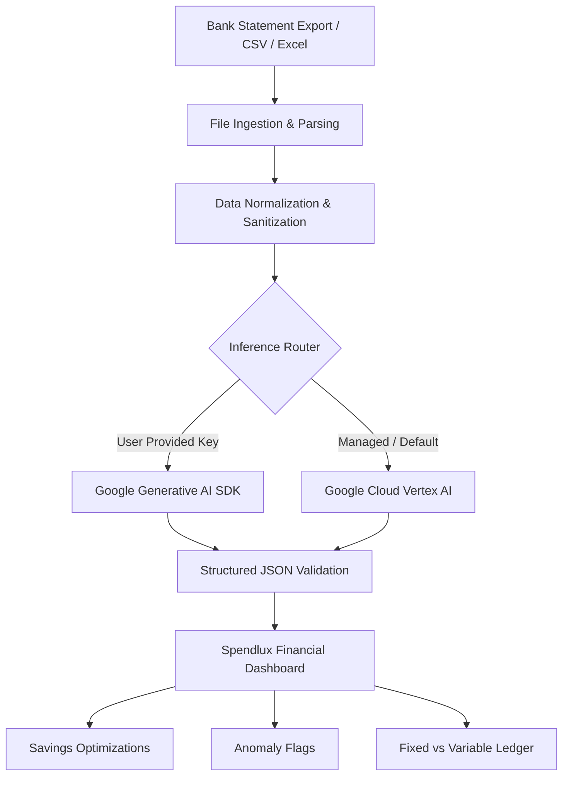

# Spendlux — AI Financial Auditor & Expense Intelligence

An intelligent personal finance engine built with **Next.js (App Router)** and **Google Gemini / Vertex AI**. Spendlux transforms raw, unstructured bank statement exports into categorized transactions, budget optimizations, anomaly flags, and savings recommendations with strict schema validation.

---

## Key Features

- **Automated Statement Ingestion:** Upload debit and credit bank exports (CSV/Excel/JSON) with automatic normalization into standardized financial schemas.
- **Strict Schema Enforcement:** Powered by Gemini 1.5 Flash structured output guarantees (`responseSchema`), preventing hallucinated data structures.
- **Financial Anomaly & Risk Detection:** Flags unexpected recurring spikes, duplicate charges, or suspicious merchant charges with automated reasoning.
- **Fixed vs. Variable Cost Segregation:** Analyzes lifestyle expenses and separates discretionary spending from fixed obligations.
- **Dual Inference Engine (BYOK + Enterprise Tier):**
  - **BYOK (Bring Your Own Key):** Users can supply personal Google AI Studio keys via `@google/generative-ai`.
  - **Managed Fallback:** Server-side Google Cloud Vertex AI integration via `@google-cloud/vertexai` using secure service account credentials.
- **Interactive Financial Dashboard:** Built with modern React components, responsive dark/light theme, and internationalization support.

---

## System Architecture



---

## Tech Stack

- **Framework:** Next.js (App Router, Server Actions)
- **Language:** TypeScript
- **AI / LLM:** Google Vertex AI (`@google-cloud/vertexai`), Gemini 1.5 Flash (`@google/generative-ai`)
- **Styling & UI:** Tailwind CSS, Lucide Icons, Shadcn UI patterns
- **Data Persistence & Auth:** Firebase & Firebase Admin SDK

---

## Getting Started

### 1. Clone & Install

```bash
git clone https://github.com/mmkaya-ui/spendlux.git
cd spendlux
npm install
```

### 2. Environment Configuration

Copy `.env.example` to `.env.local` and configure your credentials:

```bash
# Google Cloud Vertex AI (Server-Side)
GOOGLE_CLOUD_PROJECT_ID=your-project-id
GOOGLE_APPLICATION_CREDENTIALS_JSON='{"type": "service_account", ...}'

# Firebase Configuration
NEXT_PUBLIC_FIREBASE_API_KEY=your-firebase-key
NEXT_PUBLIC_FIREBASE_PROJECT_ID=your-firebase-project-id
```

### 3. Run Development Server

```bash
npm run dev
```

Open [http://localhost:3000](http://localhost:3000) in your browser.
